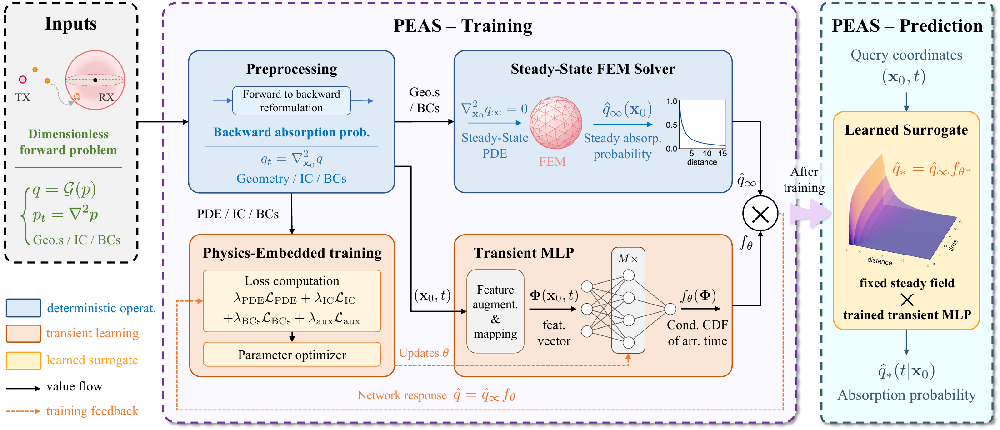
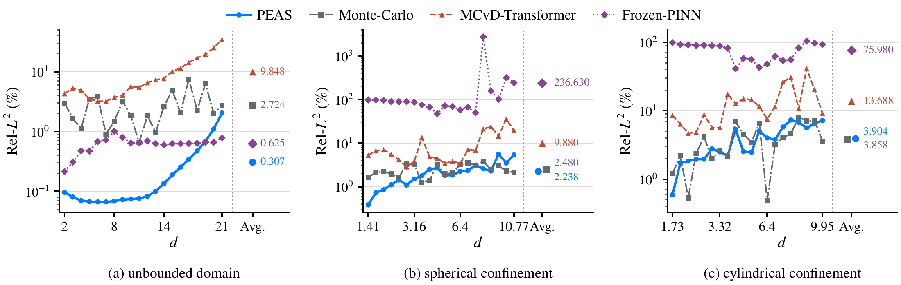
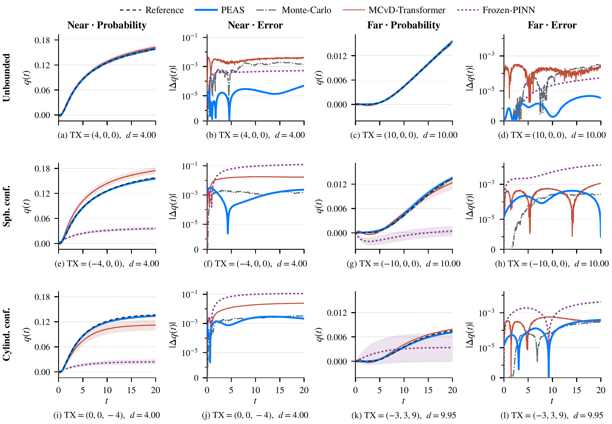
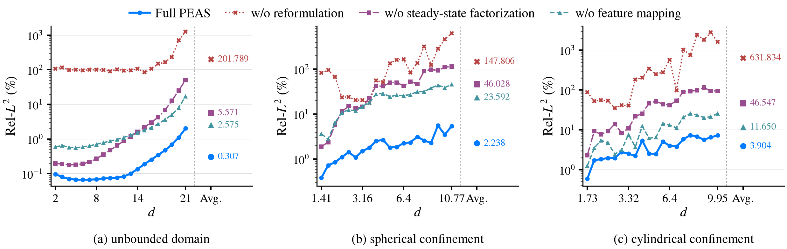

<div align="center">

# PEAS

**Direct Learning of Cumulative Absorption Probabilities in Molecular Communications via Backward Reformulation**

Point-to-sphere molecular communication · Physics-embedded learning · Three geometries

**English** | [简体中文](README.zh-CN.md)

[Results](#results) · [Quick start](#quick-start) · [Data and weights](#data-and-weights) · [Configuration guide](configs/README.md) · [Citation](#citation)

</div>

PEAS predicts the cumulative probability that a diffusing molecule released at a given position has been absorbed by a spherical receiver by time $t$. It combines a backward absorption formulation, a fixed steady-state finite-element field, and a transient multilayer perceptron:

$$
\widehat q(t\mid\mathbf{x}_0)=\widehat q_\infty(\mathbf{x}_0)\,f_\theta\!\left(\Phi(\mathbf{x}_0,t)\right).
$$

Within each fixed geometry and boundary configuration, one trained model supports queries at multiple release positions. Transient response labels do not enter the PEAS training loss; the released unbounded model uses a separate response validation set for checkpoint selection.



This repository provides the three paper experiments, archived predictions, 30 selected PEAS inference checkpoints, and code for training PEAS, its three ablations, and the comparison methods. Start with **figure reproduction** to use the supplied results without retraining or simulation.

| Paper scenario | CLI name | Geometry and outer boundary |
| --- | --- | --- |
| U: unbounded domain | `canonical` | Unit-radius absorbing RX; free exterior space |
| S: spherical confinement | `eccentric` | Outer radius 10; RX offset 3; Robin coefficient 5 |
| C: cylindrical confinement | `pipe` | Cylinder radius 5; RX offset 1; $z\in[-70,70]$; Robin wall coefficient 1; absorbing caps |

All quantities are dimensionless, with RX radius and diffusivity equal to one. The code stores confined-scene positions in the **container frame**; see the [coordinate conversion and exact Table I features](configs/README.md#coordinates-and-features).

<a id="results"></a>
## Paper results

The comparison uses 20 test positions per scenario over $t\in[0,20]$. Each neural method has 10 random runs. Monte Carlo uses an AMS estimator averaged over 128 independent simulations per position.

[](results/figures/exp2_relative_l2_positions_and_mean_1x3_new.pdf)

**Mean relative $L^2$ error (%)**, recomputed from the archived predictions:

| Method | Unbounded domain | Spherical confinement | Cylindrical confinement |
| --- | ---: | ---: | ---: |
| PEAS | **0.307** | **2.238** | 3.904 |
| Monte Carlo / AMS | 2.724 | 2.480 | **3.858** |
| MCvD-Transformer | 9.848 | 9.880 | 13.688 |
| Frozen-PINN | 0.625 | 236.630 | 75.980 |

For neural methods, errors are computed per run and position, then averaged. For Monte Carlo, the error is computed **after averaging the 128 curves**. The complete values are in [expected_metrics.csv](results/expected_metrics.csv); statistical definitions are in [data_format.md](docs/data_format.md).

<details>
<summary><strong>Experiment 1 · Probability curves and absolute errors</strong></summary>

[](results/figures/exp1_probability_error_3x4.pdf)

Shading shows pointwise 95% confidence intervals of the mean, over 10 neural runs or 128 simulations. Absolute errors here are errors of the mean prediction curves.

</details>

<details>
<summary><strong>Experiment 3 · Ablations</strong></summary>

[](results/figures/exp3_ablation_relative_l2_positions_and_mean_1x3.pdf)

The ablations evaluate backward reformulation, steady-state factorization and feature mapping in three scenarios, using 10 paired seeds per scenario and the same full PEAS ensemble as the comparison. The three variants follow the scenario-specific training and selection protocols and share evaluation grids over $[0,20]$. Full PEAS achieves the lowest overall error in each scene. [Protocol](docs/protocol.md) · [Previous and current results](docs/ablation_versions.md).

</details>

<a id="citation"></a>
## Citation

Manuscript: **PEAS: Direct Learning of Cumulative Absorption Probabilities in Molecular Communications via Backward Reformulation**, Jianfeng Sun, Yuyang Wu, Jie Zhang, and Hui Li. Repository metadata is provided in [CITATION.cff](CITATION.cff). A public paper URL, DOI, and publication venue have not yet been recorded in this release.

<a id="quick-start"></a>
## Quick start

Run commands from the repository root. Use **uv ≥0.11**; `.python-version` pins **Python 3.12.12**, and `uv.lock` pins dependencies. Archived figure reproduction and inference work on CPU; Julia and Gmsh are not required for this path.

```bash
uv cache dir
uv sync --locked --offline
```

If the local cache lacks the interpreter or a required package, use `uv sync --locked` to download it with normal certificate verification. Installation creates only the project-local `.venv`.

```bash
# Check file hashes, paper metrics, and all 30 PEAS checkpoints.
uv run --locked python scripts/verify_release.py --inference

# Recompute metrics and regenerate all three figures from archived curves.
uv run --locked python scripts/evaluate.py
uv run --locked python scripts/reproduce_figures.py
```

Outputs: `outputs/verification.json`, `outputs/metrics.csv`, and `outputs/figures/` (PDF/PNG/SVG). The paper PDFs in `results/figures/` are retained as the reference copies. The two relative-error figures have no error bars and annotate means to three decimals.

Archived figure reproduction uses the root locked CPU environment. The forward campaign ran on Linux NVIDIA GPUs; recorded training environments are included in the [provenance](configs/ablations/forward_run_provenance.json). Select a compatible PyTorch wheel and driver for `--device cuda:0`.

## Inference and training

```bash
# Apply one released checkpoint to the 20-position test grid.
uv run --locked python scripts/predict.py --scene canonical --seed 40

# Short pipeline check; omit --smoke for a full training run.
uv run --locked python scripts/train.py --scene canonical --smoke
uv run --locked python scripts/train.py --scene canonical --seed 40 --device cpu

# One ablation run; no_reformulation fits a separate model for each source.
uv run --locked python scripts/train.py --scene eccentric --variant no_features --smoke
uv run --locked python scripts/train.py --scene pipe --variant no_steady --smoke
uv run --locked python scripts/train.py --scene canonical --variant no_reformulation --source-id canonical_test_001 --smoke
```

Use `canonical`, `eccentric`, or `pipe` for `--scene`. Prediction defaults to `outputs/predictions/`; PEAS training defaults to `outputs/training/`. Each training command runs one seed, not the full ten-run ensemble. Seed lists and selection rules are in [paper_protocol.yaml](configs/paper_protocol.yaml). Supplied checkpoints contain inference weights and configuration, without optimizer/RNG state for resuming training.

<details>
<summary><strong>Query your own release positions</strong></summary>

```bash
uv run --locked python - <<'PY'
from pathlib import Path
import numpy as np
from peas.common.checkpoints import load_model

model, _ = load_model(Path("checkpoints/peas/canonical/seed_40.pt"), device="cpu")
times = np.linspace(0.0, 20.0, 641)
positions = np.array([[4.0, 0.0, 0.0], [10.0, 0.0, 0.0]])
probabilities = model.predict(times, positions)
print(probabilities.shape)  # (2, 641): positions x times
PY
```

Positions must be in the checkpoint's fluid domain and code coordinate frame. The supplied weights represent the specified geometry and boundary coefficients; changing those physical settings requires a corresponding steady field and newly trained model.

</details>

<details>
<summary><strong>Baselines, new references, and new simulation data</strong></summary>

MCvD-Transformer uses the root environment and the supplied supervised datasets. The example is a one-epoch pipeline check; use `--epochs 2000` for the paper budget.

```bash
uv run --locked python scripts/train_mcvd_transformer.py --scene canonical --epochs 1 --output outputs/mcvd_smoke
```

Frozen-PINN uses its own locked NumPy 1.x environment. It fits one source and seed per command.

```bash
uv sync --project baselines/frozen_pinn --locked --offline
# If needed, repeat the sync without --offline.
baselines/frozen_pinn/.venv/bin/python scripts/train_frozen_pinn.py --scene canonical --source-id canonical_test_001 --smoke
```

References: U is analytical; S/C use transient FEM. S requires the optional Gmsh dependency; C uses the bundled tetrahedral mesh. On Linux, Gmsh can require system OpenGL/GLU libraries.

```bash
uv run --locked python scripts/generate_reference.py --scene canonical
uv run --locked python scripts/generate_reference.py --scene pipe
uv sync --locked --extra fem
uv run --locked --extra fem python scripts/generate_reference.py --scene eccentric
```

Monte Carlo uses the bundled Julia AMS-MOD project (Julia ≥1.10; smoke-tested with 1.11.9). Its dependencies are standard libraries.

```bash
julia --project=baselines/monte_carlo -e 'using Pkg; Pkg.instantiate()'
bash scripts/generate_mc_data.sh validate --config configs/baselines/monte_carlo_canonical.toml
bash scripts/generate_mc_data.sh smoke --config configs/baselines/monte_carlo_canonical.toml --split test --limit 1 --run-id smoke --output-root outputs/monte_carlo
# Full 200-position, 128-repeat campaign; computationally expensive.
bash scripts/generate_mc_data.sh run --config configs/baselines/monte_carlo_canonical.toml --run-id formal --output-root outputs/monte_carlo
```

Use the `eccentric`/`pipe` config for the other scenes. Set `JULIA=/path/to/julia` if needed. See the [configuration guide](configs/README.md) for replicas, schedules, solver settings, and effective overrides, and [reproduction.md](docs/reproduction.md) for more operational details.

</details>

<a id="data-and-weights"></a>
## Data and weights

| Location | Contents |
| --- | --- |
| [data/reference/](data/reference/) | Test positions, times and analytical/transient-FEM reference responses; historical training grids |
| [data/steady/](data/steady/) | Fixed FEM steady fields and the cylindrical mesh needed by PEAS |
| [data/training/](data/training/) | Three 200-position MCvD datasets, split 160/20/20; position manifests |
| [data/validation/](data/validation/) | Actual canonical selection grid, MCvD validation subsets, Frozen-PINN tuning-point records |
| [data/predictions/comparison/](data/predictions/comparison/) | Per-run method predictions; MC also retains all 128 simulation curves |
| [data/predictions/ablations/](data/predictions/ablations/) | Per-run predictions for the three ablated variants |
| [checkpoints/peas/](checkpoints/peas/) | Ten selected inference checkpoints per scene |
| [results/](results/) | Expected metrics, independent plotting audit and one reference PDF per experiment |
| `outputs/` | Locally generated predictions, training runs, metrics and figures |

NPZ arrays are documented in [data_format.md](docs/data_format.md). Reference responses have shape `(20,T)` and archived model predictions `(10,20,T)`, with `T=641` for U and `T=801` for S/C. Align arrays by IDs and times. Baseline checkpoints are not bundled; their archived predictions reproduce the paper figures.

The [scripts/](scripts/) directory contains executable task entry points; [src/peas/](src/peas/) contains reusable model, physics and evaluation code. [baselines/](baselines/) contains the adapted comparison implementations. [manifest.json](manifest.json) records file origins and checksums. Environments, caches and new `outputs/` are created only when you install or run the project.

## Experimental scope and licensing

The [protocol](docs/protocol.md) describes training, model selection, data splits and metric aggregation. [Version notes](docs/ablation_versions.md) retain the previous forward-ablation results and explain the figure update.

The original PEAS code license is **pending**; [LICENSE](LICENSE) currently grants no open-source license. Third-party provenance and notices are retained in [THIRD_PARTY.md](THIRD_PARTY.md), including the unresolved license status of the pinned MCvD upstream source.
