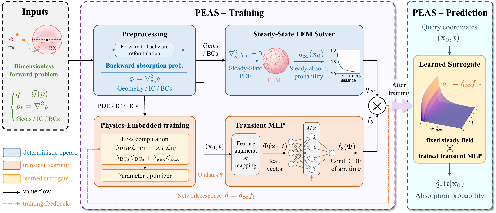
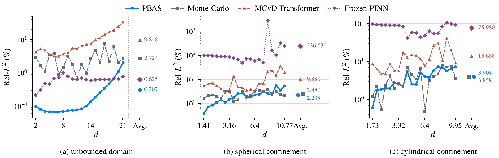
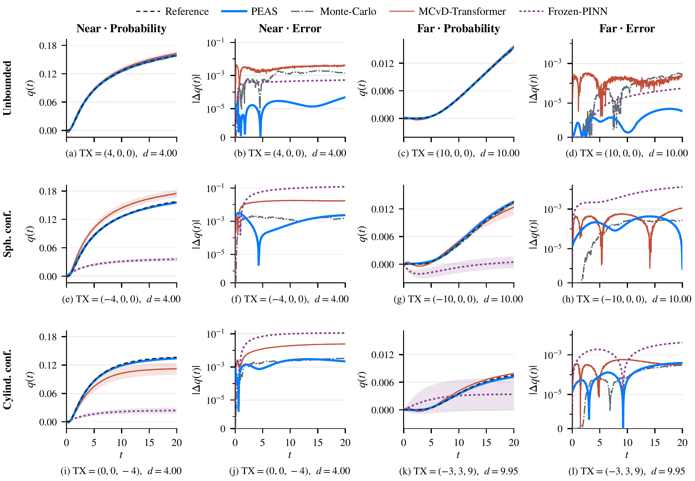
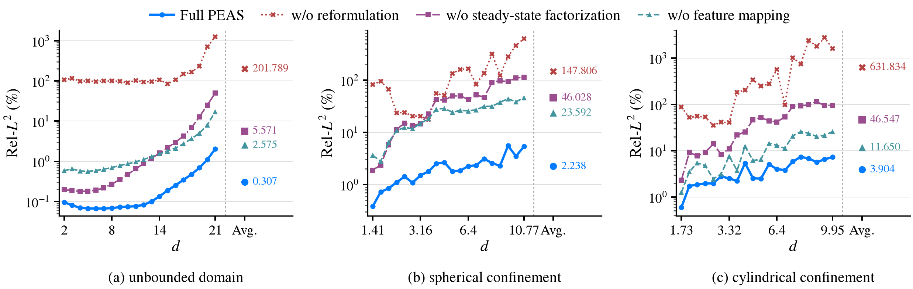

<div align="center">

# PEAS

**Direct Learning of Cumulative Absorption Probabilities in Molecular Communications via Backward Reformulation**

点源到球形接收器的分子通信 · 物理嵌入学习 · 三种几何场景

[English](README.md) | **简体中文**

[论文结果](#results) · [快速开始](#quick-start) · [数据与权重](#data-and-weights) · [配置说明](configs/README.zh-CN.md) · [引用](#citation)

</div>

PEAS 预测从给定位置释放的扩散分子在时间 $t$ 之前被球形接收器吸收的累计概率。方法结合后向吸收问题、固定的稳态有限元场与瞬态多层感知机（MLP）：

$$
\widehat q(t\mid\mathbf{x}_0)=\widehat q_\infty(\mathbf{x}_0)\,f_\theta\!\left(\Phi(\mathbf{x}_0,t)\right).
$$

对于固定的几何与边界条件，一个训练完成的模型可以查询多个释放位置。PEAS 的训练损失不使用瞬态响应标签；本仓库的无界场景模型使用独立响应验证集选择检查点。



本仓库提供论文三组实验的代码、归档预测、30 份最终 PEAS 推理权重，以及 PEAS、三种消融变体和对比方法的训练入口。建议先从**重绘论文图**开始，无需重新训练或运行粒子仿真。

| 论文场景 | 命令行名称 | 几何与外边界 |
| --- | --- | --- |
| U：unbounded domain（无界域） | `canonical` | 单位半径吸收球 RX，外部为自由空间 |
| S：spherical confinement（球形受限域） | `eccentric` | 外球半径 10，RX 偏心距 3，Robin 系数 5 |
| C：cylindrical confinement（圆柱受限域） | `pipe` | 圆柱半径 5，RX 偏心距 1，$z\in[-70,70]$，Robin 侧壁系数 1，吸收端面 |

所有量均已无量纲化，RX 半径与扩散系数为 1。受限场景的数据采用**容器坐标系**；与论文坐标的转换及 Table I 的完整特征公式见[配置说明](configs/README.zh-CN.md#coordinates-and-features)。

<a id="results"></a>
## 论文结果

所有方法在每个场景的 20 个测试位置、$t\in[0,20]$ 上比较。各神经方法使用 10 次随机运行；Monte Carlo 使用每个位置 128 次独立仿真平均后的 AMS 估计量。

[](results/figures/exp2_relative_l2_positions_and_mean_1x3_new.pdf)

由归档预测重新计算的**平均相对 $L^2$ 误差（%）**：

| 方法 | 无界域 | 球形受限域 | 圆柱受限域 |
| --- | ---: | ---: | ---: |
| PEAS | **0.307** | **2.238** | 3.904 |
| Monte Carlo / AMS | 2.724 | 2.480 | **3.858** |
| MCvD-Transformer | 9.848 | 9.880 | 13.688 |
| Frozen-PINN | 0.625 | 236.630 | 75.980 |

神经方法先计算每次运行、每个位置的误差，再取平均；Monte Carlo 则**先平均 128 条曲线，再计算误差**。完整数值见 [expected_metrics.csv](results/expected_metrics.csv)，统计定义见 [data_format.md](docs/data_format.md)。

<details>
<summary><strong>实验 1 · 概率曲线与绝对误差</strong></summary>

[](results/figures/exp1_probability_error_3x4.pdf)

阴影为均值的逐时刻 95% 置信区间，来自 10 次神经模型运行或 128 次仿真。该图中的绝对误差是平均预测曲线与参考曲线之间的误差。

</details>

<details>
<summary><strong>实验 3 · 消融比较</strong></summary>

[](results/figures/exp3_ablation_relative_l2_positions_and_mean_1x3.pdf)

消融实验在三个场景中检验后向重构、稳态分解和特征映射的作用，每个场景使用 10 个配对种子，完整 PEAS 与对比实验使用同一组模型。三个变体遵循各场景的训练与选模协议，并在相同的 $[0,20]$ 网格上评价。完整 PEAS 在三个场景中均取得最低总体误差。[实验协议](docs/protocol.md) · [前后两版结果](docs/ablation_versions.md)。

</details>

<a id="citation"></a>
## 引用

论文题名：**PEAS: Direct Learning of Cumulative Absorption Probabilities in Molecular Communications via Backward Reformulation**；作者：Jianfeng Sun、Yuyang Wu、Jie Zhang、Hui Li。仓库引用元数据见 [CITATION.cff](CITATION.cff)。当前版本尚未登记公开论文链接、DOI 或发表刊会信息。

<a id="quick-start"></a>
## 快速开始

以下命令均在仓库根目录执行。使用 **uv ≥0.11**；`.python-version` 固定 **Python 3.12.12**，`uv.lock` 固定依赖。归档绘图和推理可在 CPU 上运行，无需 Julia 或 Gmsh。

```bash
uv cache dir
uv sync --locked --offline
```

若本机缓存缺少解释器或依赖包，改用 `uv sync --locked`，通过正常证书验证下载。安装只创建本项目的 `.venv`。

```bash
# 检查文件校验值、论文指标与全部 30 份 PEAS 推理权重。
uv run --locked python scripts/verify_release.py --inference

# 从归档曲线重新计算指标、生成三张论文图。
uv run --locked python scripts/evaluate.py
uv run --locked python scripts/reproduce_figures.py
```

结果写入 `outputs/verification.json`、`outputs/metrics.csv` 和 `outputs/figures/`（PDF/PNG/SVG）。`results/figures/` 保留论文参考 PDF。两张相对误差图不显示 error bar，平均值标注保留三位小数。

归档绘图使用根目录锁定的 CPU 环境。前向消融在 Linux NVIDIA GPU 上完成，训练环境记录见[来源清单](configs/ablations/forward_run_provenance.json)。使用 `--device cuda:0` 时，请配置兼容的 PyTorch wheel 和驱动。

## 推理与训练

```bash
# 使用一份已发布权重，对 20 个测试位置进行推理。
uv run --locked python scripts/predict.py --scene canonical --seed 40

# 短流程检查；去掉 --smoke 即为完整训练。
uv run --locked python scripts/train.py --scene canonical --smoke
uv run --locked python scripts/train.py --scene canonical --seed 40 --device cpu

# 单次消融；no_reformulation 需要对每个释放位置单独训练。
uv run --locked python scripts/train.py --scene eccentric --variant no_features --smoke
uv run --locked python scripts/train.py --scene pipe --variant no_steady --smoke
uv run --locked python scripts/train.py --scene canonical --variant no_reformulation --source-id canonical_test_001 --smoke
```

`--scene` 可选 `canonical`、`eccentric`、`pipe`。推理默认写入 `outputs/predictions/`，PEAS 训练默认写入 `outputs/training/`。每条训练命令只运行一个种子，不会自动运行完整十次实验。种子列表和选择规则见 [paper_protocol.yaml](configs/paper_protocol.yaml)。已提供的检查点包含推理权重与配置，不含恢复训练所需的优化器和随机数状态。

<details>
<summary><strong>查询自己的释放位置</strong></summary>

```bash
uv run --locked python - <<'PY'
from pathlib import Path
import numpy as np
from peas.common.checkpoints import load_model

model, _ = load_model(Path("checkpoints/peas/canonical/seed_40.pt"), device="cpu")
times = np.linspace(0.0, 20.0, 641)
positions = np.array([[4.0, 0.0, 0.0], [10.0, 0.0, 0.0]])
probabilities = model.predict(times, positions)
print(probabilities.shape)  # (2, 641): positions x times
PY
```

位置必须处于检查点对应的流体区域，并使用代码坐标系。随附权重对应指定的几何与边界系数；改变这些物理设置，需要相应的稳态场及重新训练的模型。

</details>

<details>
<summary><strong>基线训练、参考解与仿真数据生成</strong></summary>

MCvD-Transformer 使用根目录环境及随附监督数据。示例为 1 epoch 的流程检查；论文训练预算使用 `--epochs 2000`。

```bash
uv run --locked python scripts/train_mcvd_transformer.py --scene canonical --epochs 1 --output outputs/mcvd_smoke
```

Frozen-PINN 使用独立锁定的 NumPy 1.x 环境，每条命令拟合一个释放位置、一个随机种子。

```bash
uv sync --project baselines/frozen_pinn --locked --offline
# 若缓存不足，去掉 --offline 再同步。
baselines/frozen_pinn/.venv/bin/python scripts/train_frozen_pinn.py --scene canonical --source-id canonical_test_001 --smoke
```

参考解：U 使用解析解，S/C 使用瞬态 FEM。S 需要可选 Gmsh 依赖；C 使用随附四面体网格。Linux 上 Gmsh 可能需要系统 OpenGL/GLU 运行库。

```bash
uv run --locked python scripts/generate_reference.py --scene canonical
uv run --locked python scripts/generate_reference.py --scene pipe
uv sync --locked --extra fem
uv run --locked --extra fem python scripts/generate_reference.py --scene eccentric
```

Monte Carlo 使用随附 Julia AMS-MOD 工程（Julia ≥1.10，已用 1.11.9 做冒烟测试），只依赖 Julia 标准库。

```bash
julia --project=baselines/monte_carlo -e 'using Pkg; Pkg.instantiate()'
bash scripts/generate_mc_data.sh validate --config configs/baselines/monte_carlo_canonical.toml
bash scripts/generate_mc_data.sh smoke --config configs/baselines/monte_carlo_canonical.toml --split test --limit 1 --run-id smoke --output-root outputs/monte_carlo
# 完整的 200 位置、128 次重复实验，计算量较大。
bash scripts/generate_mc_data.sh run --config configs/baselines/monte_carlo_canonical.toml --run-id formal --output-root outputs/monte_carlo
```

另两个场景使用对应的 `eccentric`/`pipe` 配置；必要时设置 `JULIA=/path/to/julia`。副本数、调度、求解器及实际生效设置见[配置说明](configs/README.zh-CN.md)，更多操作说明见 [reproduction.md](docs/reproduction.md)。

</details>

<a id="data-and-weights"></a>
## 数据与权重

| 位置 | 内容 |
| --- | --- |
| [data/reference/](data/reference/) | 测试坐标、时间、解析/瞬态 FEM 参考响应，以及历史训练网格 |
| [data/steady/](data/steady/) | PEAS 使用的固定 FEM 稳态场与圆柱网格 |
| [data/training/](data/training/) | 三份各 200 位置的 MCvD 数据集，按 160/20/20 划分；位置清单 |
| [data/validation/](data/validation/) | canonical 实际选择模型用的网格、MCvD 验证子集、Frozen-PINN 调参位置记录 |
| [data/predictions/comparison/](data/predictions/comparison/) | 各方法逐次预测；MC 同时保留全部 128 次仿真曲线 |
| [data/predictions/ablations/](data/predictions/ablations/) | 三种消融变体的逐次预测 |
| [checkpoints/peas/](checkpoints/peas/) | 每场景 10 份最终推理检查点 |
| [results/](results/) | 预期指标、独立绘图数值核对表，以及每组实验一份参考 PDF |
| `outputs/` | 用户运行产生的预测、训练记录、指标与图片 |

NPZ 格式见 [data_format.md](docs/data_format.md)。参考响应形状为 `(20,T)`，归档神经模型预测为 `(10,20,T)`；U 的 `T=641`，S/C 的 `T=801`。读取时按 ID 与时间对齐。仓库未提供基线权重，其归档预测足以重绘论文图。

[scripts/](scripts/) 放可直接执行的任务入口，[src/peas/](src/peas/) 放可复用的模型、物理约束和评价实现，[baselines/](baselines/) 放适配后的对比方法。[manifest.json](manifest.json) 记录来源与文件校验值。环境、缓存和新的 `outputs/` 仅在安装或运行时生成。

## 实验范围与许可证

[实验协议](docs/protocol.md) 说明训练、模型选择、数据划分及误差统计方法。[版本说明](docs/ablation_versions.md) 保留前一版前向消融结果，并说明本次图片更新。

PEAS 原创代码许可证目前**待定**，[LICENSE](LICENSE) 尚未授予开源许可。第三方来源和声明保留于 [THIRD_PARTY.md](THIRD_PARTY.md)，其中也说明了固定版本 MCvD 上游代码的许可证未明确问题。
